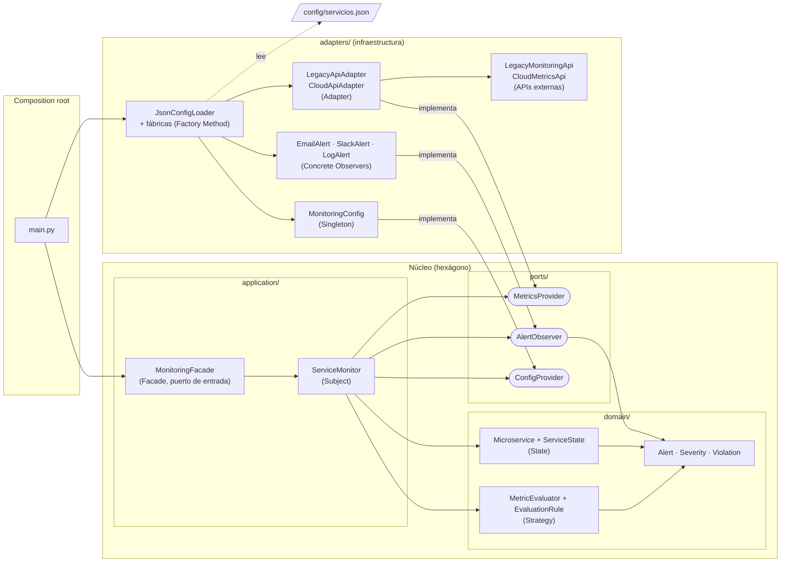
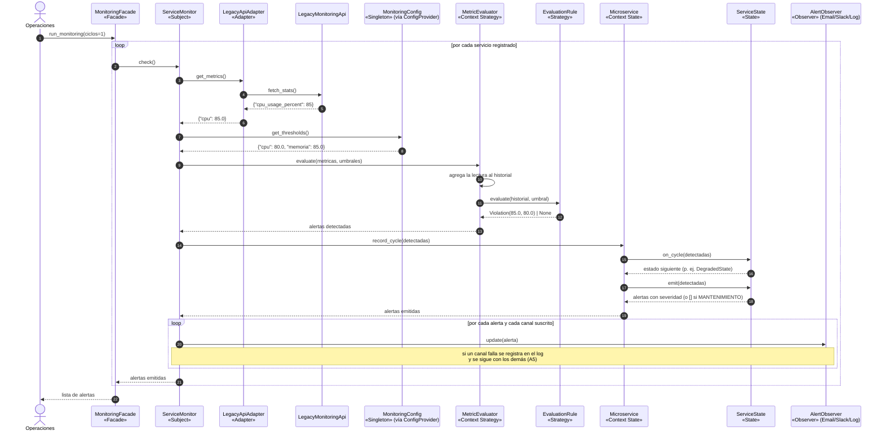
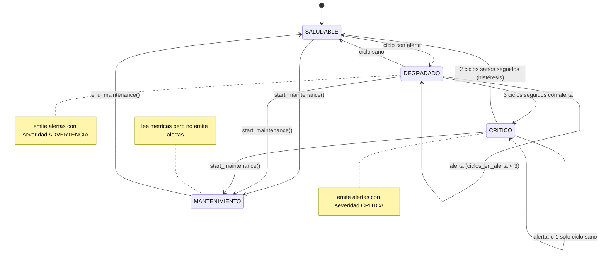
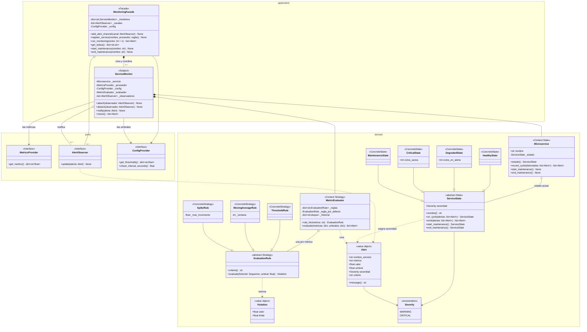

# Documento de arquitectura

Sistema de Monitoreo de Microservicios — Proyecto Final 1, IS294 Arquitectura Cliente Servidor.

Los diagramas de este documento son la versión renderizable (GitHub muestra los bloques Mermaid) de los archivos
fuente en [`uml/`](uml/).

## 1. Contexto y problema

Una fintech necesita vigilar varios microservicios. Cada uno expone sus métricas a través de una API externa distinta
(una API legada con `{"cpu_usage_percent": 85}`, una API en la nube con fracciones `{"cpuLoad": 0.45}`), los umbrales
deben poder cambiarse en caliente, las alertas tienen que llegar por varios medios (email, Slack, log) y se quiere:

- evitar alertas repetidas cuando una métrica oscila alrededor del umbral (*flapping*);
- poder elegir **cómo** se evalúa cada métrica (valor actual, promedio, subida brusca);
- armar el sistema desde un archivo de configuración, sin tocar código para agregar servicios o canales.

El riesgo principal es que la lógica de negocio (cuándo un servicio está mal y qué se notifica) quede acoplada a las
APIs externas, a los canales concretos o a la forma de guardar la configuración.

## 2. Estilo arquitectónico: Hexagonal (Puertos y Adaptadores)

### 2.1 Qué es y cómo se aplica

El sistema se divide en un **núcleo** (dominio + casos de uso) que no conoce ninguna tecnología externa, y
**adaptadores** que conectan ese núcleo con el mundo exterior. La comunicación entre ambos pasa solo por **puertos**
(interfaces abstractas definidas por el núcleo).

| Capa | Carpeta | Responsabilidad | Puede importar |
|---|---|---|---|
| Dominio | `domain/` | Reglas de negocio: estado de salud (State), reglas de evaluación (Strategy), alertas | nada del proyecto |
| Puertos | `ports/` | Contratos que el núcleo necesita: `MetricsProvider`, `AlertObserver`, `ConfigProvider` | `domain` |
| Aplicación | `application/` | Casos de uso: orquestar un ciclo (`ServiceMonitor`) y punto de entrada (`MonitoringFacade`) | `domain`, `ports` |
| Adaptadores | `adapters/` | APIs externas y sus adapters, canales de alerta, configuración, carga desde JSON, fábricas | `domain`, `ports` |
| Composition root | `main.py` | Crea los adaptadores concretos y los inyecta en el núcleo | todo |

- **Puerto de entrada (driving):** `MonitoringFacade`. Es lo único que usan los equipos de operaciones (y `main.py`).
- **Puertos de salida (driven):** `MetricsProvider` (de dónde salen las métricas), `AlertObserver` (a dónde van las
  alertas), `ConfigProvider` (de dónde salen umbrales e intervalo).

### 2.2 Regla de dependencias y cómo se verifica

Todas las dependencias de código apuntan **hacia el dominio**. `application` nunca importa de `adapters`: no sabe si las
métricas vienen de una API legada o de la nube, ni si una alerta se envía por email o Slack, ni que la configuración es
un Singleton.

La regla no depende de la disciplina: [`tests/test_arquitectura.py`](../tests/test_arquitectura.py) analiza los `import`
de cada archivo con `ast` y **falla** si una capa importa una capa prohibida. Se comprobó agregando a propósito un
`import` de `adapters` dentro de `domain/`: la prueba falló señalando el archivo.

### 2.3 Por qué Hexagonal y no otro estilo

| Alternativa | Por qué se descartó |
|---|---|
| **Capas tradicionales** (presentación → negocio → datos) | El negocio dependería de la capa de datos/infraestructura. Aquí hay *varias* tecnologías externas del mismo nivel (APIs de métricas, canales, config) y lo importante es que el núcleo no dependa de ninguna; Hexagonal invierte esa dependencia con puertos. |
| **Arquitectura dirigida por eventos** (bus de eventos) | Las alertas sí son eventos, pero el sistema es un solo proceso con un ciclo síncrono. Un bus agregaría infraestructura (broker, suscripciones asíncronas) sin resolver un problema real; el Observer ya da el desacoplamiento necesario entre quien detecta y quien notifica. |
| **Microservicios** | Es un único componente pequeño; repartirlo en servicios agregaría red, despliegue y consistencia distribuida sin beneficio. |

Hexagonal encaja porque el problema central es **aislar la lógica de monitoreo de las tecnologías externas
intercambiables**, que es exactamente lo que resuelven los puertos y adaptadores.

### 2.4 Diagrama de componentes

## 3. Flujo de datos de un ciclo de monitoreo

1. `MonitoringFacade.run_monitoring()` recorre los `ServiceMonitor` registrados.
2. **Adapter:** el monitor pide `get_metrics()` al puerto `MetricsProvider`; el adaptador traduce el formato de la API
   externa a `{"cpu": 85.0, ...}` en porcentaje.
3. **Singleton (vía puerto):** lee los umbrales con `ConfigProvider.get_thresholds()`.
4. **Strategy:** `MetricEvaluator` guarda la lectura en el historial de la métrica y le aplica su `EvaluationRule`;
   cada regla incumplida produce una `Alert` con su `criterio`.
5. **State:** `Microservice.record_cycle()` delega en su `ServiceState`, que decide el estado siguiente y qué alertas
   se emiten (con severidad ADVERTENCIA o CRITICA, o ninguna en mantenimiento).
6. **Observer:** el monitor notifica cada alerta emitida a todos los `AlertObserver` suscritos; si un canal falla se
   registra en el log y se sigue con los demás.

## 4. Patrones de diseño (GoF)

| Patrón | Tipo | Problema concreto que resuelve | Participantes | Archivo |
|---|---|---|---|---|
| **Adapter** | Estructural | Cada API externa devuelve un formato distinto; el núcleo no debe conocerlos | Target `MetricsProvider` · Adapters `LegacyApiAdapter`, `CloudApiAdapter` · Adaptees `LegacyMonitoringApi`, `CloudMetricsApi` | `adapters/metrics_adapters.py` |
| **Facade** | Estructural | Operaciones no debe saber crear monitores, suscribir canales ni coordinar ciclos | `MonitoringFacade` | `application/monitoring_facade.py` |
| **Observer** | Comportamiento | Quien detecta la alerta no debe conocer los canales; un canal nuevo no debe tocar el monitoreo | Subject `ServiceMonitor` · Observer `AlertObserver` · `EmailAlert`, `SlackAlert`, `LogAlert` | `application/service_monitor.py`, `adapters/alert_channels.py` |
| **Singleton** | Creacional | Todos los monitores deben leer los mismos umbrales y ver los cambios en caliente | `MonitoringConfig` (se **inyecta** por el puerto `ConfigProvider`, no se llama global) | `adapters/monitoring_config.py` |
| **State** | Comportamiento | Escalamiento, histéresis anti-*flapping* y mantenimiento sin `if/elif` sobre el estado | Context `Microservice` · State `ServiceState` · `HealthyState`, `DegradedState`, `CriticalState`, `MaintenanceState` | `domain/service_state.py` |
| **Strategy** | Comportamiento | Elegir por métrica cómo se evalúa (valor actual, promedio, subida brusca) sin modificar el evaluador | Context `MetricEvaluator` · Strategy `EvaluationRule` · `ThresholdRule`, `MovingAverageRule`, `SpikeRule` | `domain/evaluation_rules.py` |
| **Factory Method** | Creacional | Convertir el texto del JSON (`"email"`, `"legacy"`, `"promedio"`) en objetos sin `if/elif` por tipo | Creator `Factory[T]` · 8 fábricas concretas · `FactoryRegistry` | `adapters/factories.py` |

### 4.1 Diagrama de estados del servicio (patrón State)

## 5. Principios SOLID en el código

| Principio | Dónde se ve | Evidencia |
|---|---|---|
| **S** – Responsabilidad única | `MetricEvaluator` solo detecta alertas; `Microservice` solo gestiona su estado; `ServiceMonitor` solo orquesta un ciclo; `JsonConfigLoader` solo traduce el JSON | Auditoría A3: antes `Microservice.evaluate()` evaluaba **y** cambiaba estado |
| **O** – Abierto/cerrado | Reglas, estados, canales, proveedores y fábricas se agregan con clases nuevas | `test_ocp_una_regla_nueva...` y `test_ocp_un_tipo_nuevo...` agregan una regla y un canal "teams" sin modificar el código existente |
| **L** – Sustitución de Liskov | Cualquier `EvaluationRule`, `ServiceState`, `MetricsProvider` o `AlertObserver` es intercambiable | Pruebas `test_lsp_*` parametrizadas sobre todas las implementaciones |
| **I** – Segregación de interfaces | Puertos de un solo propósito: `get_metrics()`, `update()`, `get_thresholds()` | Auditoría A2: se quitó `get_cpu_usage()` obligatorio, que forzaba a todo proveedor a tener CPU |
| **D** – Inversión de dependencias | `application` depende de puertos; las implementaciones se inyectan desde `main.py` | Auditoría A1: `ServiceMonitor` ya no llama `MonitoringConfig()` por dentro; las pruebas usan una `ConfigFija` falsa |

**Eliminación de condicionales por polimorfismo:** no existe ningún `if/elif` que pregunte por el *tipo* de estado,
de regla, de canal o de proveedor. El estado decide su transición (`on_cycle`), la regla decide si se incumple
(`evaluate`), y el tipo del JSON se resuelve con una búsqueda en el registro de fábricas.

## 6. Diagramas de clases

### 6.1 Núcleo (domain + ports + application)

### 6.2 Adaptadores y fábricas

```mermaid
%% Diagrama de clases (2/2): adapters/ y cómo implementan los puertos del núcleo.
classDiagram
    direction TB

    namespace ports {
        class MetricsProvider {
            <<interface>>
            +get_metrics()* dict~str,float~
        }
        class AlertObserver {
            <<interface>>
            +update(alerta: Alert)* None
        }
        class ConfigProvider {
            <<interface>>
            +get_thresholds()* dict~str,float~
            +check_interval_seconds()* float
        }
    }

    namespace adapters_metricas {
        class LegacyMonitoringApi {
            <<Adaptee>>
            +fetch_stats() dict
        }
        class CloudMetricsApi {
            <<Adaptee>>
            +query() dict
        }
        class LegacyApiAdapter {
            <<Adapter>>
            -LegacyMonitoringApi _api
            +get_metrics() dict~str,float~
        }
        class CloudApiAdapter {
            <<Adapter>>
            -CloudMetricsApi _api
            +get_metrics() dict~str,float~
        }
    }

    namespace adapters_canales {
        class EmailAlert {
            <<ConcreteObserver>>
            -str _destinatario
            +update(alerta: Alert) None
        }
        class SlackAlert {
            <<ConcreteObserver>>
            -str _canal
            +update(alerta: Alert) None
        }
        class LogAlert {
            <<ConcreteObserver>>
            -Logger _logger
            +update(alerta: Alert) None
        }
    }

    namespace adapters_config {
        class MonitoringConfig {
            <<Singleton>>
            -MonitoringConfig _instancia$
            -Lock _candado_creacion$
            -Lock _candado_datos
            -dict~str,float~ _umbrales
            -float _intervalo_segundos
            +get_threshold(metrica: str) float
            +set_threshold(metrica: str, porcentaje: float) None
            +get_thresholds() dict~str,float~
            +check_interval_seconds() float
        }
        class JsonConfigLoader {
            -MonitoringConfig _config
            -Registries _registros
            +load_file(ruta: Path) SystemDefinition
            +load(datos: dict) SystemDefinition
        }
        class SystemDefinition {
            +list~AlertObserver~ canales
            +list~ServiceDefinition~ servicios
        }
        class ServiceDefinition {
            +str nombre
            +MetricsProvider proveedor
            +dict~str,EvaluationRule~ reglas
        }
    }

    namespace adapters_fabricas {
        class Factory~T~ {
            <<abstract Creator>>
            +create(parametros: dict)* T
        }
        class FactoryRegistry~T~ {
            -str _familia
            -dict~str,Factory~ _fabricas
            +register(tipo: str, fabrica: Factory) None
            +types() list~str~
            +create(especificacion: dict) T
        }
        class Registries {
            +FactoryRegistry canales
            +FactoryRegistry proveedores
            +FactoryRegistry reglas
        }
        class EmailChannelFactory {
            <<ConcreteCreator>>
        }
        class SlackChannelFactory {
            <<ConcreteCreator>>
        }
        class LogChannelFactory {
            <<ConcreteCreator>>
        }
        class LegacyProviderFactory {
            <<ConcreteCreator>>
        }
        class CloudProviderFactory {
            <<ConcreteCreator>>
        }
        class ThresholdRuleFactory {
            <<ConcreteCreator>>
        }
        class MovingAverageRuleFactory {
            <<ConcreteCreator>>
        }
        class SpikeRuleFactory {
            <<ConcreteCreator>>
        }
    }

    %% Adapter
    LegacyApiAdapter ..|> MetricsProvider
    CloudApiAdapter ..|> MetricsProvider
    LegacyApiAdapter --> LegacyMonitoringApi : traduce
    CloudApiAdapter --> CloudMetricsApi : traduce

    %% Observer
    EmailAlert ..|> AlertObserver
    SlackAlert ..|> AlertObserver
    LogAlert ..|> AlertObserver

    %% Singleton
    MonitoringConfig ..|> ConfigProvider
    MonitoringConfig --> MonitoringConfig : _instancia

    %% Factory Method
    EmailChannelFactory --|> Factory
    SlackChannelFactory --|> Factory
    LogChannelFactory --|> Factory
    LegacyProviderFactory --|> Factory
    CloudProviderFactory --|> Factory
    ThresholdRuleFactory --|> Factory
    MovingAverageRuleFactory --|> Factory
    SpikeRuleFactory --|> Factory
    EmailChannelFactory ..> EmailAlert : crea
    SlackChannelFactory ..> SlackAlert : crea
    LogChannelFactory ..> LogAlert : crea
    LegacyProviderFactory ..> LegacyApiAdapter : crea
    CloudProviderFactory ..> CloudApiAdapter : crea
    FactoryRegistry o-- "1..*" Factory : tipo a fábrica
    Registries *-- "3" FactoryRegistry

    %% Carga de configuración
    JsonConfigLoader --> Registries : usa
    JsonConfigLoader --> MonitoringConfig : aplica umbrales
    JsonConfigLoader ..> SystemDefinition : retorna
    SystemDefinition *-- "0..*" ServiceDefinition
```

## 7. Decisiones de diseño

| # | Decisión | Motivo | Alternativa descartada |
|---|---|---|---|
| D1 | `MonitoringConfig` vive en `adapters/` e implementa `ConfigProvider` | Guardar la configuración es un detalle de infraestructura; el núcleo solo necesita leer umbrales | Dejarla en `domain/` y llamarla global (dependencia oculta, A1) |
| D2 | Separar `MetricEvaluator` (Strategy) de `Microservice` (State) | Son dos razones de cambio distintas: cómo se evalúa y cómo reacciona el servicio | Un solo método `evaluate()` con ambas cosas (A3) |
| D3 | Las reglas no guardan estado; el historial lo mantiene `MetricEvaluator` | Una misma regla se puede compartir entre servicios y es trivial de probar | Que cada regla guarde sus lecturas |
| D4 | Cada transición crea un objeto de estado nuevo con sus contadores | Los estados son casi inmutables y fáciles de razonar | Estados únicos compartidos con contadores en el Context |
| D5 | `JsonConfigLoader` devuelve una `SystemDefinition` y `main.py` hace el cableado | `adapters/` no puede importar `application/` sin romper la regla hexagonal | Que el cargador registre directamente en la fachada |
| D6 | Las fábricas se eligen por un registro `tipo → fábrica` | Agregar un tipo es una línea `register(...)`, sin modificar código existente | `if tipo == "email": ... elif ...` |

## 8. Limitaciones conocidas

- Las APIs externas y los canales están **simulados** (muestras fijas y salida por consola).
- El monitoreo es **síncrono**: un proveedor lento retrasa el ciclo completo.
- Las pruebas comparten la instancia del Singleton; el aislamiento entre pruebas depende de no reutilizar los mismos
  umbrales.
- Otros puntos abiertos están registrados en la [bitácora de IA](bitacora_ia.md), en la auditoría de cada entrada.
